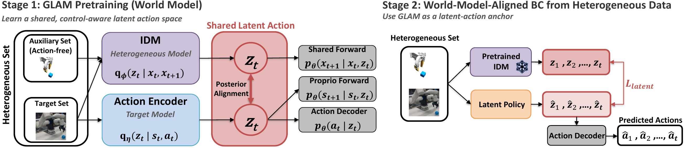
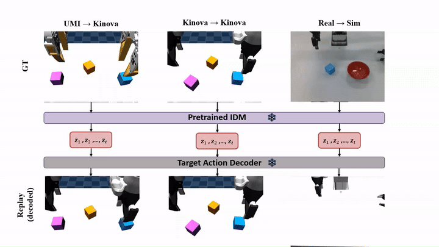

# GLAM: Imitation from Heterogeneous Demonstrations using Grounded Latent‑Action World Models

[[Project Page]](https://viccccciv.github.io/glam/) [[arXiv]](https://arxiv.org/abs/2606.21672)

[Tianyou Wang](https://viccccciv.github.io/Tianyou-Wang/), [Anson Lei](https://ori.ox.ac.uk/people/anson-lei), [Joe Watson](https://joemwatson.github.io/), [Ingmar Posner](https://eng.ox.ac.uk/people/ingmar-posner)

Applied Artificial Intelligence Lab, Oxford Robotics Institute, University of Oxford

This is the official repository of GLAM, a pair of latent-action generative models that leverage heterogeneous demonstrations for supervising downstream imitation learning. 

Following the paper's setup, the heterogeneous dataset combines a small **target set** — action-labelled demonstrations on our Kinova robot (Frank) — with a larger, action-free **auxiliary set** collected by a floating UMI gripper. The examples in this repository use UMI as the auxiliary source and Kinova-sim as the target. The same interfaces also take real-robot demonstrations as the target source for real-world tasks (see the notes in steps 1 and 3): if you collect data on a real robot, it plugs into the pipeline exactly like the sim target set.



The pipeline has four steps:

1. **Pretrain the GLAM world model** on the heterogeneous dataset (`glam/train.py`).
2. **Label the robot dataset with action latents** using the pretrained world model (`glam/generate_policy_dataset.py`).
3. **Train the downstream policy** — either the MIP baseline (observation → actions) or the GLAM-augmented policy (observation → action latent → actions) (`policy/train.py`).
4. **Evaluate the policy** in the MuJoCo Frank (our bimanual robot) simulation (`sim_eval/inference_mujoco.py`).

## Installation

Create the conda environment (named `glam`):

```bash
conda env create -f environment.yml
conda activate glam
```

Or install the dependencies into an existing Python 3.10 environment:

```bash
pip install -r requirements.txt
```

Notes:

- A CUDA GPU is required for training. The pinned `torch==2.1.0` wheel ships with CUDA 12.1.
- The policy vision encoder uses DINOv2 (ViT-S/14) via `torch.hub`; the weights are downloaded automatically on first use.

### Simulation evaluation environment

Simulation evaluation and data generation use a separate conda environment (named `glam_eval`, Python 3.11 + MuJoCo):

```bash
conda env create -f environment_eval.yml
conda activate glam_eval
```

For headless rendering set `MUJOCO_GL=egl` (already done in `sim_eval/run_inference.sh`).

## Data layout

Each task lives in its own data root with one folder per data source. Task IDs: **task 1 = stack two**, **task 2 = stack three**.

```
data/stack_two/
├── umi/task_01/success/0001/
│   ├── *.npz                  # trajectory (poses, joints, actions)
│   ├── front_frames/          # raw RGB frames (0000.png, 0001.png, ...)
│   ├── front_frames_mask/     # object masks
│   ├── overhead_frames/
│   └── overhead_frames_mask/
├── umi/task_01/success/0002/
│   └── ...
└── frank/task_01/success/...  # same structure for Frank episodes
```

### Download the datasets

Both tasks are hosted on Hugging Face at [`VVVVVVVVIC/glam-datasets`](https://huggingface.co/datasets/VVVVVVVVIC/glam-datasets) — `stack_two.tar` (29 GB, 500 UMI + 500 Frank episodes) and `stack_three.tar` (31 GB, 500 UMI + 200 Frank episodes). Download and extract them into `data/`:

```bash
pip install -U huggingface_hub
hf download VVVVVVVVIC/glam-datasets --repo-type dataset --local-dir data/
tar -xf data/stack_two.tar -C data/ && rm data/stack_two.tar
tar -xf data/stack_three.tar -C data/ && rm data/stack_three.tar
```

This produces exactly the layout above (`data/stack_two/...`, `data/stack_three/...`), ready for the training commands below.

The datasets were collected with the scripted experts in `data_gen/` (runnable in the `glam_eval` environment) — see [docs/data_generation.md](docs/data_generation.md) for the full data-collection pipeline: scripted Frank/UMI demonstrations in simulation, SAM 3 object-mask extraction for GLAM-O, and the real-robot data format for collecting your own target-set demonstrations.

## Training

The commands below use task 1 (stack two); for task 2 (stack three) replace the data root and every `--*_tasks 1` with `2`.

### 1. Pretrain the GLAM world model

```bash
# task 1 (stack two)
python glam/train.py \
    --umi_roots data/stack_two/umi/ --frank_roots data/stack_two/frank/ \
    --umi_tasks 1 --frank_tasks 1 \
    --umi_max_episodes 400 --frank_max_episodes 100 \
    --latent_dim 8 --max_steps 15000 \
    --save_dir checkpoints/glam --use_wandb

# task 2 (stack three)
python glam/train.py \
    --umi_roots data/stack_three/umi/ --frank_roots data/stack_three/frank/ \
    --umi_tasks 2 --frank_tasks 2 \
    --umi_max_episodes 400 --frank_max_episodes 100 \
    --latent_dim 16 --max_steps 25000 \
    --save_dir checkpoints/glam --use_wandb
```

The model and loss configuration from the paper (camera views, EE-conditioned IDM, forward models, posterior alignment, action reconstruction, ...) is the default — see the flags in `glam/train.py`; each boolean component can be switched off with `--no-<flag>` for ablations. To co-train with an additional target source such as real-robot demonstrations (for real-world tasks in the paper), add `--frank_real_roots <root>` together with `--frank_real_tasks` / `--frank_real_max_episodes`.

By default the world model consumes the binary object masks (`*_frames_mask/`, one channel per view), which is the GLAM-O in the paper. Adding `--raw_image` switches the vision input to the raw RGB frames (`*_frames/`, three channels per view), which is the GLAM in the paper.

Training stops after `--max_steps` gradient steps. Checkpoints are written to `checkpoints/glam/<run_name>/`.

### 2. Generate the policy dataset (action-latent labels)

Run the pretrained world model over the dataset to label every transition with its action latent. Pass the **task-level** directories as roots:

```bash
python glam/generate_policy_dataset.py \
    --umi_roots data/stack_two/umi/task_01/ --frank_roots data/stack_two/frank/task_01/ \
    --tasks 1 --umi_subsample 1 --frank_subsample 1 \
    --ckpt checkpoints/glam/<run_name>/best_val.pth \
    --out_root data/stack_two/policy_dataset

python glam/generate_policy_dataset.py \
    --umi_roots data/stack_three/umi/task_02/ --frank_roots data/stack_three/frank/task_02/ \
    --tasks 2 --umi_subsample 1 --frank_subsample 1 \
    --ckpt checkpoints/glam/<run_name>/best_val.pth \
    --out_root data/stack_three/policy_dataset
```

Model configuration (latent dim, camera views, image mode, ...) is read from the checkpoint automatically. Each episode produces a `policy_data.npz` under `--out_root`, mirroring the source layout.

### 3. Train the downstream policy

**MIP baseline** (observation → actions, target data only):

```bash
python policy/train.py \
    --data_root data/stack_two/policy_dataset --image_root data/stack_two \
    --base_policy --frank_max_episodes 100 \
    --save_dir checkpoints/policy/task1 --use_wandb
```

**GLAM-augmented policy** (predict the action latent, then decode to actions; the auxiliary UMI data joins the latent supervision):

```bash
python policy/train.py \
    --data_root data/stack_two/policy_dataset --image_root data/stack_two \
    --train_decoder --frank_max_episodes 100 --umi_max_episodes 400 \
    --save_dir checkpoints/policy/task1 --use_wandb
```

The paper's policy configuration (MIP, action chunk 20, dual-view DINOv2 encoder, batch size, learning rate) is the default — see `policy/train.py`. For self-collected real-robot episodes labelled in step 2 join through `--frank_real_max_episodes N`; they then provide the action supervision as the target set.

`--image_root` is the task data root from the layout above — the policy loads RGB frames from the original episode folders. Policy checkpoints are written to `checkpoints/policy/<run_name>/`.

### 4. Evaluate the policy in simulation

Evaluation runs in the `glam_eval` environment, from the `sim_eval/` directory. Since the best BC checkpoint is not known a priori, `run_inference.sh` sweeps several epochs (`epoch_60` ... `epoch_140`) for both the baseline and the GLAM-augmented policy. Each checkpoint is evaluated with randomized initial cube poses — 5 seed groups × 10 trials — and reported as an overall success rate with a Wilson 95% confidence interval.

Edit the variables at the top of `sim_eval/run_inference.sh` (`TASK`, `CKPT_ROOT`, and the run-folder names in `RUNS`), then:

```bash
conda activate glam_eval
cd sim_eval
bash run_inference.sh
```

`--task 1` evaluates stack two (right arm), `--task 2` stack three (dual arm). All model configuration is read from the checkpoint. Each run writes rollout videos, action/EE/cube trajectory plots, and a `random_init_summary.csv` to its output folder.

### 5. Evaluate the pretrained GLAM world model

To test whether GLAM learns a genuinely shared action space, we encode unseen trajectories from different sources with the same pretrained IDM, and decode the latent sequences with the same target action decoder:



This repository provides the UMI and Kinova-sim transfers. Example outputs (source episode on top, decoded-latent replay on the bottom): [UMI transfer](figure/umi_transfer_demo.mp4) · [Kinova-sim transfer](figure/frank_transfer_demo.mp4).

`glam/eval_glam.py` runs the whole pipeline in one command (in the `glam` training environment):

1. **Action decoder** — trains a small MLP from the frozen GLAM latents to robot actions.
2. **Held-out predictions** — decodes GLAM latents into actions on held-out Frank episodes (from the checkpoint's `val_indices.txt`) and on UMI episodes, saving `val_predictions_{frank,umi}.pkl`.

```bash
conda activate glam
python glam/eval_glam.py \
    --glam_ckpts checkpoints/glam/<run_name>/best_val.pth \
    --umi_roots data/stack_two/umi/ --frank_roots data/stack_two/frank/ \
    --umi_tasks 1 --frank_tasks 1 --umi_task_ids 1 \
    --frank_num_episodes 10 \
    --umi_base_dir data/stack_two/umi/task_01/success/ --episode_ids 0 1 2 3 4 5
```

Model configuration is read from the checkpoint; outputs go to `wm_eval/{action_decoder_ckpts, inference_results}/`.

**Replay the predictions in simulation.** The pkl files are then replayed in MuJoCo (in the `glam_eval` environment): Frank episodes replay the expert and predicted actions stacked in one video from the episode's real initial state; UMI episodes replay the predicted actions with the original UMI demonstration video stacked on top, time-aligned per prediction step. Edit the variables at the top of `sim_eval/run_eval.sh`, then:

```bash
conda activate glam_eval
cd sim_eval
bash run_eval.sh
```

Each replay writes comparison videos, per-joint action curves, and an `evaluation_logs.txt` with per-episode success next to the pkl (`sim_results_{frank,umi}/`).

## License

Released under the terms of the [LICENSE](LICENSE) file.
